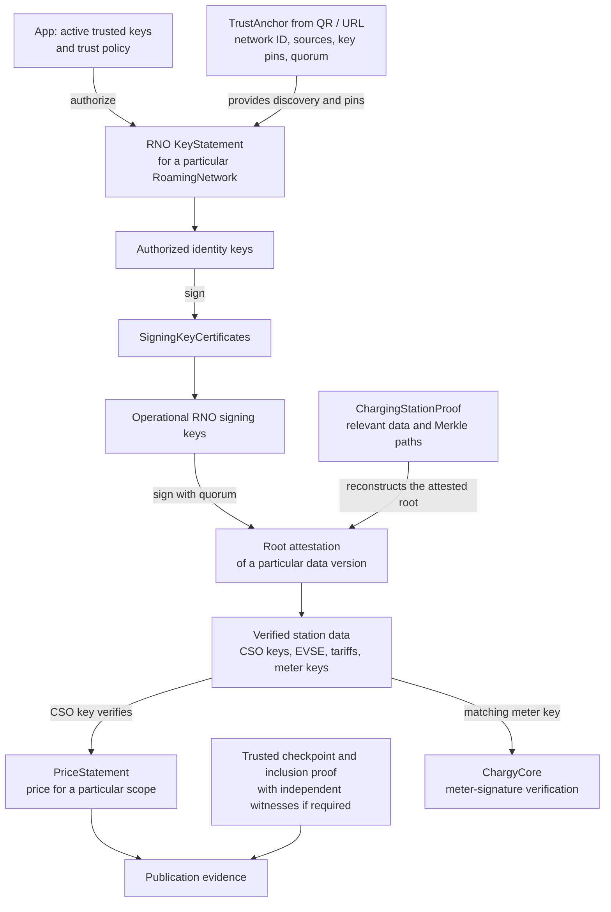

# WWCP POI Trust Architecture

Status: 31 October 2026. This document describes the intended trust chain,
the current integration gaps and the logical risks identified while integrating
`@open-charging-cloud/wwcp-poi@0.1.0` into Chargy.

A TrustAnchor and an authenticated RoamingNetworkOperator provide the trust
foundation. Validating a particular charging station and its tariff additionally
requires signed data versions and the corresponding inclusion proofs.

The current app imports and manages TrustAnchors and derives a roaming-network
list from them. It now downloads and verifies the RNO's **KeyStatement** after an
explicit import action. It does not yet verify station proofs, runtime prices or
publication evidence. The bundled public-key JSONL file and its build integration
exist, but the file currently contains no keys.
Camera scans, clipboard text and file imports now share TrustAnchor detection,
including JSON documents and QR images. The first preview shows only anchor
content and key hashes, with Import and Cancel. It does not display validation or
local trust information and does not access the network. Import downloads the
small `/keyStatement` document with full public keys and signatures, verifies it
and stores the original document when its signatures and validity pass. Unknown
signers do not prevent storage. After loading, users can optionally grant
or withdraw trust for individual key pins within that exact anchor configuration.
This is a local trust decision, not a cryptographic verification result.

Related documents:

- [WWCP POI integration plan](WWCP-POI-Integration.md) (German)
- [Current Trust Management implementation](TrustManagement.md) (German)
- [Bundled public-key configuration](../src/trust/README.md)

## 1. Data structures and their relationships

### Domain objects

The following tree shows conceptual relationships, rather than a complete JSON
schema or the exact placement of every serialized field:

```text
RoamingNetwork
├── operator: RoamingNetworkOperator
│   ├── identityKeys
│   ├── keyStatement
│   └── signingKeyCertificates
│       └── certified operational signing keys
│
└── Charging Station Operators (CSOs / CPOs)
    ├── their own signing keys
    ├── charging tariffs
    └── charging pools
        └── charging stations
            └── EVSEs
                ├── tariff references
                └── energy meters and their public keys
```

Keys belong to particular parties or devices: the RoamingNetworkOperator (RNO),
a CSO or an energy meter. The RoamingNetwork connects this information in a
verifiable data version.

A **KeyStatement belongs to an RNO in the context of a particular
RoamingNetwork**. It identifies the network and its operator and contains identity
keys, a minimum consensus, validity information and signatures. Operational RNO
signing keys are authorized through SigningKeyCertificates.

### Cryptographic trust chain



The initial authorization step is essential: information received through an
untrusted QR code cannot establish its own trust. Discovery URLs and display
texts must also remain distinct from authenticated operator information.

| Structure | What it establishes |
| --- | --- |
| **TrustAnchor** | Discovery locations, network identity, expected key pins grouped by holder, and quorum. The app must authorize this starting configuration through its trust policy. |
| **KeyStatement** | Which identity keys the RNO authorizes for this network. It can carry multiple signatures. |
| **SigningKeyCertificate** | Which operational RNO key an authorized identity key has certified, including permitted usages and validity. |
| **Root attestation + ChargingStationProof** | That the supplied station data belongs to a particular attested data version. Only relevant data and Merkle paths are needed, rather than the complete network. |
| **PriceStatement** | Which authorized operator declared which prices, for which scope and time interval. |
| **Checkpoint + inclusion proof** | That a particular data version or PriceStatement is included in a confirmed history. Witnesses can add independent confirmation. |

Quorum counts distinct **holders**, not simply signatures or keys. Several keys
belonging to one holder must not multiply that holder's vote. The library's
[operator trust implementation](https://github.com/OpenChargingCloud/WWCP_POI.TS/blob/master/src/verifier/trust.ts)
implements holder-based verification and uses the larger quorum required by the
TrustAnchor and KeyStatement.

The current `TA-2` TrustAnchor format is not itself a signed document. Multiple
signatures are carried by the KeyStatement and subsequent attestations. A signed
TrustAnchor could be additional evidence, but the existing chain can work without
one when its initial pins and trust policy are independently authorized.
KeyStatement signatures do not authenticate the TrustAnchor's URLs or display
texts.

## 2. User journey: anchor preview, download, verification and storage

This chapter describes the current app flow. Both examples below are complete,
matching [test fixtures](../tests/fixtures/TrustAnchors/README.md), including real
test signatures. Their public test keys must never become production trust roots.
The reserved `.example` endpoints illustrate the API and do not serve these files.
Ed25519 keeps the examples short; the separation between hashes in the anchor and
full downloaded public keys also applies to larger PQC keys.

### Step 1: display only the scanned or supplied TrustAnchor

QR codes have limited payload capacity, and practical scan reliability also
depends on code density, error correction and capture conditions. Full public
keys, particularly PQC keys, can consume a substantial part of that capacity.
The TrustAnchor therefore includes fixed-size **SHA-256 COSE Key Thumbprints**
instead of the full keys: 32 bytes per key before the enclosing CBOR and Base45
encoding. This keeps the discovery payload compact while pinning the exact key
material. The full keys and signatures are downloaded only after Import and
checked against those pins; a matching hash does not itself grant trust.

A camera scan, clipboard paste, selected file or dropped file opens the same
preview. At this point the app shows only the anchor's contents: network ID,
sources, optional display texts, key fingerprints grouped by holder and quorum.
The actions are **Import** and **Cancel**, kept visible in the dialog footer.
There are no validation results, bundled-key counts or trust decisions yet.
The app neither downloads POI data nor reads or writes its local trust store in
this step. Cancel closes the preview without importing anything.

The JSON representation of the example anchor is:

```json
{
  "@id": "CHARGY-TA-TEST",
  "@context": "https://open.charging.cloud/contexts/wwcp/roamingNetwork/trustAnchor/v2",
  "urls": [
    "https://poi.example/RNs/CHARGY-TA-TEST",
    "https://mirror.example/RNs/CHARGY-TA-TEST"
  ],
  "keys": [
    [
      "01565176601c895cad856c02c18a1c14eb9f49b26e2fdcae7040c2530350982b",
      "dd2fb4e18b5e1ce30c4633aaa5f681da79c3b32998cc5aa21b1149c37231a6ac"
    ],
    "72d16fafc7e5497618246178631d650fef01a4aca770c965dd8b551760bad6dc"
  ],
  "name": {
    "de": "Chargy-Testnetz",
    "en": "Chargy test network"
  },
  "description": {
    "en": "Public test fixture. Never use these keys in production."
  },
  "minConsensus": 2
}
```

Source: [`anchor.json`](../tests/fixtures/TrustAnchors/anchor.json).
The compact QR representation encodes the same anchor as deterministic CBOR in
Base45 with the prefix `WWCP/TA-2:`. Its fingerprints are SHA-256 COSE Key
Thumbprints, encoded as 32-byte values in CBOR and as 64 lowercase hexadecimal
characters in JSON. The complete public keys are absent from the anchor.

Chargy primarily renders each fingerprint as a blue **Drunken Bishop** image,
computed locally from those exact bytes. Holder groups stay visible; a short
hash caption and expandable full hash with a copy action remain available.
The same renderer is used in downloaded-key views, explicit trust confirmations
and Trust Management. Its versioned 17×9 mapping and palette are consistent
across these views. Image colors encode visit counts, not trust. Randomart is
not collision-free, so cryptographic checks still compare complete thumbprints.

Each outer `keys` entry represents one holder. Here the first holder has two
keys and the second holder has one. `minConsensus: 2` requires both holders;
signatures by the first holder's two keys still count as one holder's vote.
This **2-of-2-holder quorum with three keys** is a deliberate test example, not
a required configuration for roaming networks. It demonstrates that one holder
may have several keys, for example during key rotation, without gaining extra
votes. Holder A's two keys alone must leave the quorum at 1 / 2; one authorized
signature from A and one from B can satisfy 2 / 2. Another deployment could use
two out of three distinct holders instead, independently of each holder's key
count. The fixture retains two keys for A specifically to exercise that boundary.
Display names and source URLs are discovery information, not authenticated
operator details.

### Step 2: Import downloads the signed KeyStatement

Only clicking **Import** starts the download. For this anchor the app requests:

```http
GET https://poi.example/RNs/CHARGY-TA-TEST/keyStatement
Accept: application/json
```

It tries the corresponding endpoint at the listed mirror if the first source
fails or supplies unusable data. The app downloads this small document rather
than the complete RoamingNetwork or its charging-station tree. This step does
not yet fetch SigningKeyCertificates, station proofs, tariffs or checkpoints.
Requests omit credentials, reject redirects and follow the build's transport
restrictions, with a 15-second timeout per source and a 1 MiB response limit.
Cancel remains available during loading and aborts the pending import.

The matching KeyStatement contains the actual public keys and signatures:

```json
{
  "@context": "https://open.charging.cloud/contexts/wwcp/roamingNetwork/keyStatement/v3",
  "roamingNetworkId": "CHARGY-TA-TEST",
  "roamingNetworkOperatorId": "CHARGY-TEST-RNO",
  "identityKeys": [
    {
      "@id": "01565176601c895cad856c02c18a1c14eb9f49b26e2fdcae7040c2530350982b",
      "key": "owEBIAYhWCCBOXcOqH0XX1ajVGbDTH7My42KkbTuN6Jd9g9bj8mzlA==",
      "holder": "Test holder A"
    },
    {
      "@id": "72d16fafc7e5497618246178631d650fef01a4aca770c965dd8b551760bad6dc",
      "key": "owEBIAYhWCDtSSjGKNHCxurpAziQWZVhKVknOlxj+TY2wUYUrIc30Q==",
      "holder": "Test holder B"
    },
    {
      "@id": "dd2fb4e18b5e1ce30c4633aaa5f681da79c3b32998cc5aa21b1149c37231a6ac",
      "key": "owEBIAYhWCCKiOPddAnxlf1S2y08ul1yymcJvx2UEhvzdIgBtA9vXA==",
      "holder": "Test holder A"
    }
  ],
  "minConsensus": 2,
  "signedAt": "2026-01-01T00:00:00.000Z",
  "validUntil": "2030-01-01T00:00:00.000Z",
  "signatures": [
    {
      "algorithm": "Ed25519",
      "keyId": "dd2fb4e18b5e1ce30c4633aaa5f681da79c3b32998cc5aa21b1149c37231a6ac",
      "value": "DjbD4tfY88gzvgYY8FZZ7R1UpVDtLYgnkPktsBMx/U3tBpo6B+k33auJEJgiGlTaOARF2Yjitl2WVWDKEzDaBw=="
    },
    {
      "algorithm": "Ed25519",
      "keyId": "01565176601c895cad856c02c18a1c14eb9f49b26e2fdcae7040c2530350982b",
      "value": "r9QQSr8SWKRma1GXzjqZ6JiER1kWvb1ShTUMT8hx3coSCKA1KRAWdVP3GrBCvWJobZ/E/R1Ak4XsBRquB+ghAw=="
    },
    {
      "algorithm": "Ed25519",
      "keyId": "72d16fafc7e5497618246178631d650fef01a4aca770c965dd8b551760bad6dc",
      "value": "JqakOV1s8WuFkzBRZ5U3Z7sWKa/0YKK9jk9OYnOYfiAJN6TNptmMWWMi92hhKECZY2NBha46fHU6lpCcoz1ADg=="
    }
  ]
}
```

Source: [`key-statement.json`](../tests/fixtures/TrustAnchors/key-statement.json).
Each `key` is Base64-encoded deterministic CBOR containing a public COSE key.
Its thumbprint must match its `@id` and the corresponding anchor pin. The keys
are sorted by ID. Each signature identifies its algorithm and signing key;
`value` contains the Base64 signature over the library-defined canonical signing
input. The signatures cover the KeyStatement, not the anchor's URLs or texts.

The anchor hashes are carried through the import unchanged and used as pins;
they are never replaced by IDs asserted by the downloaded document. For the
first example key, the app requires this relationship before counting it as an
authorized pinned signer:

```text
TrustAnchor.keys[0][0]
    == KeyStatement.identityKeys[0]["@id"]
    == hex(SHA-256 COSE Key Thumbprint of the downloaded public key)
```

The library computes the thumbprint from the actual COSE public-key material
according to RFC 9679, rather than trusting the supplied `@id`. It rejects key
material whose thumbprint differs from that ID. The app then selects locally
authorized pins from the original anchor, retaining their holder grouping, and
passes them to `KeyStatement.verifyHolders`. A self-consistent downloaded key
with a different hash cannot replace a pinned key or contribute its trusted vote.
Additional identity keys may be present in the statement, but their presence
alone does not create trusted bootstrap votes. Matching the pin proves the key
material's identity; trusting that pin remains a separate policy or user decision.

### Step 3: show verification results and save the import

The app parses the original JSON with the WWCP parser, checks the network
binding and public-key thumbprints, verifies the signatures and validity, and
evaluates signer trust and holder quorum against the current local policy.
It shows **Signatures valid**, **Signers trusted**, **Quorum satisfied** and
**Validity period valid** separately. Full keys, the signed source document and
verification details are available by expanding their details.

For this example, with no configured or manually trusted keys, all three
signatures can be valid while signer trust fails and the trusted quorum is
**0 / 2**. The app still saves the anchor and original downloaded document when
their structural checks, signatures and validity pass. Unknown signers do not
prevent import, and storing the import grants no additional key trust.

Malformed or incorrectly bound responses are rejected. Invalid signatures or
expired documents produce failure results and are not saved; an existing cached
document is retained. Download failures leave the initial preview available for
retry, and storage failures are explicitly reported rather than shown as success.

### Step 4: optionally trust keys and manage the saved network

After loading, **Trust this key …** opens a separate confirmation showing the
fingerprint, network ID, sources, holder assignment and quorum. Confirming grants
trust only within this exact anchor configuration. Canceling that confirmation
grants no trust and does not undo the already imported anchor.

Trusting one key of holder A and the key of holder B satisfies this example's
two-holder quorum. Trusting only holder A's two keys does not. Each decision
recalculates the checks locally without another download. It cannot repair a bad
signature or expired validity. The whole validation field becomes green only
when every required check passes.

The following data is kept in IndexedDB **`ChargyTrustManagement`**, version **1**:

| Location | Persisted information and timing |
| --- | --- |
| `trustAnchors` record | After a successful load and signature/validity checks: anchor identity hash (`id`), canonical anchor (`qrCode`), original supplied text (`sourceText`) and UTC import time (`importedAt`). |
| `trustAnchors.downloadedData` | At the same time: actual KeyStatement source URL (`sourceURL`), UTC download time (`downloadedAt`) and original JSON text (`text`). A valid refresh updates this document without duplicating the anchor or removing existing key decisions. |
| `trustAnchors.trustedKeys` | Only after an explicit key confirmation: key ID (`id`) and UTC decision time (`acceptedAt`). Withdrawing manual trust removes that decision. |
| `deletedBundledKeys` | Only when a user locally removes a bundled key: its ID. This is separate from anchor imports and scoped manual trust. |
| App bundle | The build-validated JSONL trust roots. Imports and manual decisions do not modify this bundled source. |

No green verification result is persisted as authority. Opening **Settings →
Trust Management → Roaming networks** or **Trust Anchors** reparses and checks
the stored document against current trust and time without fetching POI data.
**Reload record** explicitly requests `/keyStatement` again. Rescanning a known
anchor starts with the same content-only preview; clicking Import refreshes its
document and preserves its existing local trust decisions.

Deleting an anchor removes its cached document and manual decisions. Deleting a
network removes all its currently grouped anchors and their embedded data.
Bundled keys and their separate local exclusions remain unchanged. Storage is
local to the app's browser origin and profile; clearing browser data also removes
the imported documents and local decisions.

## 3. Missing integration steps

1. **Bootstrap authorization.** Check the scanned configuration against the active
   app keys and trust policy before using its pins as a trusted starting point.
2. **Complete RNO verification.** KeyStatement download, identity-key parsing,
   signatures, local signer trust, holder quorum, network binding and validity are
   now integrated. SigningKeyCertificates and the binding of operational RNO
   signing keys to subsequent attestations remain to be integrated.
3. **Load a station proof.** Request a ChargingStationProof for the actual station
   or EVSE and verify it using `verifyChargingStation(...)`.
4. **Verify the tariff and price.** Resolve tariff references, verify the relevant
   PriceStatement and establish its applicability to the EVSE, charging time and
   charging mode, including ad hoc versus contractual charging.
5. **Verify publication.** Require the relevant checkpoints and inclusion proofs
   before claiming that an ad hoc tariff's publication has been established.
6. **Bind the result to the charging session.** Match the proven meter key to the
   station, EVSE and meter ID, then supply it to ChargyCore to verify the signed
   energy measurements.

The library provides `verifyChargingStation`, `verifyPriceStatements` and
`verifyEvidence`. Some publication evidence is optional in the
[evidence verifier](https://github.com/OpenChargingCloud/WWCP_POI.TS/blob/master/src/verifier/evidence.ts).
The app must explicitly require all evidence needed for the claim it displays.
A successful call alone does not establish that publication evidence is complete.

The integration also needs persistent storage and refresh rules for verified
documents, key succession and revocation handling, and retention of the evidence
used for an individual charging session. Preserve the signed source documents and
use the library's parsing and canonicalization rather than reconstructing signed
content through ordinary JSON round trips.

**EMP offers and contractual charging require separate treatment.** The existing
PriceStatement verifier covers the CPO path. It does not imply general validation
of arbitrary EMP offers or contracts.

## 4. Logical risks and required safeguards

### Import must not grant trust

The library treats the TrustAnchor supplied to a verifier as an already pinned
trust basis. It does not consult Chargy's bundled JSONL file or locally removed
keys. Passing every imported anchor directly to the verifier would bypass the
app's trust management.

Importing and displaying an anchor must remain possible with incomplete trust.
Storage, bootstrap authorization and cryptographic verification are separate
operations. The current preview and management UI do not yet perform
verification of station or tariff documents. They now verify downloaded
KeyStatements and offer explicit, separate manual acceptance of individual pins
after loading. The confirmation displays sources, holder
assignment and quorum; decisions do not transfer to another anchor policy.

### Quorum and holder identities need an authorized foundation

An attacker must not be able to define several apparent holders, supply their own
keys and choose a convenient quorum in a QR code. The app needs a rule for which
trusted keys may authorize which RNOs or networks. Allowing every bundled key to
endorse any network is a possible policy, but it must be a deliberate choice.
Manual pin acceptance now records the user's decision for the displayed policy;
it does not modify the bundled roots or authenticate a downloaded statement.

Additional unknown signers should not invalidate an otherwise satisfied quorum.
For example, three signatures, including valid signatures by two trusted distinct
holders, can satisfy a quorum of two. The UI should show the trusted-holder count
and threshold rather than requiring every optional signer to be trusted.

### A network ID alone does not authenticate network identity

The current [network grouping](../src/ts/roamingNetworks.ts) uses only the
RoamingNetworkId. Before authentication, equal IDs do not establish that two
anchors refer to the same network. Such entries currently share a view, and
[network deletion](../src/ts/trustStore.ts) removes all anchors with that ID.

Before extending verification, define a local network identity tied to the
authenticated RNO and its trust lineage. It must support legitimate key rotation;
using only the current key as the permanent identity would prevent that.

### Signed, published and currently applicable are different claims

A valid CPO signature proves the CPO's declaration. An inclusion proof establishes
that the declaration is included in a confirmed data set. Neither alone proves
that this is the currently applicable ad hoc price at this EVSE, that no competing
statement exists, or that it was published before charging began.

Those claims need matching scope, time relationships, freshness rules and,
where required, independently witnessed checkpoints. A later checkpoint can prove
inclusion by that checkpoint, but cannot by itself establish publication before
an earlier charging session. A signer's `signedAt` value is not an independent
timestamp.

The library's [checkpoint verifier](https://github.com/OpenChargingCloud/WWCP_POI.TS/blob/master/src/verifier/checkpoints.ts)
requires zero witnesses by default. The app must explicitly configure its witness
trust and minimum witness count if its publication policy requires them.

### Old valid data can still mislead

A server can return an older, correctly signed version. Persist previously
observed versions and checkpoints, detect rollbacks and distinguish trust today
from evidence valid at the time charging began. Version tracking must account for
epochs as well as revisions.

Removing a local root key must trigger reevaluation of dependent current trust
and cached results. Historical session evidence should remain available, with its
historical and current trust assessments distinguished. Conflicting views also
need detection; valid signatures alone do not prevent an operator from presenting
different histories to different clients.

### Verified data does not establish every possible claim

A station proof establishes the data version attested by the RNO. Independently
proving the CSO's authorization of every original change requires the relevant
signed change history. Cryptographic validity also does not independently prove
physical facts at the charging site.

Verification must check the requested station and EVSE, required tariff
dependencies and the matching meter. Missing data or warnings must not become a
green success for a claim that depends on that data. RNO and CSO signing keys
must never be substituted for the energy meter key used by ChargyCore.

## 5. User-visible verification levels

Keep the three requested checks and add claims at the level they describe:

| Level | Checks shown to the user |
| --- | --- |
| **Roaming network** | Signatures valid · Signers trusted · Quorum satisfied |
| **Charging station** | Inclusion in the confirmed data version proven |
| **Tariff and price** | Issuer authorized · Applicable to this charging session · Publication proven |
| **Energy measurements** | Meter key associated with the station · Measurement signatures valid |

Each level can have its own green check when its requirements are satisfied.
An overall green status must cover all claims it represents. Unknown, unavailable,
invalid and incomplete evidence must remain distinguishable.

Details should be progressively accessible: first the outcome, then participating
holders and quorum, followed by document identities, key fingerprints, validity
times, signatures, roots, Merkle paths and checkpoint or witness evidence.
This follows the existing approach used for signed meter values and OCMF records.
