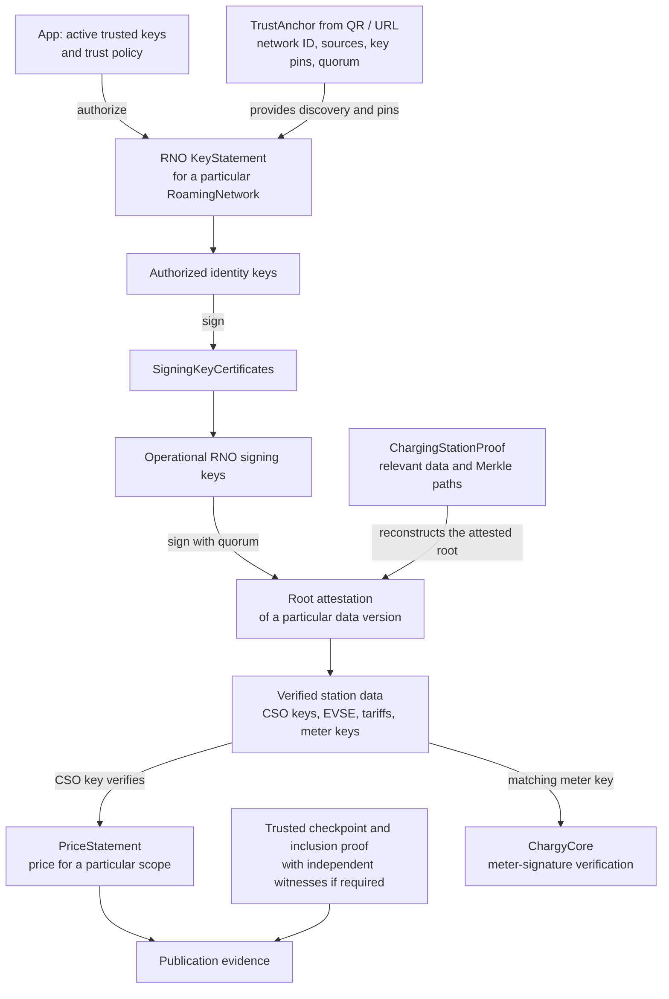

# WWCP POI Trust Architecture

Status: 31 October 2026. This document describes the intended trust chain,
the current integration gaps and the logical risks identified while integrating
`@open-charging-cloud/wwcp-poi@0.1.0` into Chargy.

A TrustAnchor and an authenticated RoamingNetworkOperator provide the trust
foundation. Validating a particular charging station and its tariff additionally
requires signed data versions and the corresponding inclusion proofs.

The current app imports and manages TrustAnchors and derives a roaming-network
list from them. It does **not yet download or verify** RoamingNetworkOperators,
KeyStatements or station proofs. The bundled public-key JSONL file and its build
integration exist, but the file currently contains no keys.

Related documents:

- [WWCP POI integration plan](WWCP-POI-Integration.md) (German)
- [Current Trust Management implementation](TrustManagement.md) (German)
- [Bundled public-key configuration](../src/trust/README.md)

## 1. Data structures and their relationships

### Domain objects

The following tree shows conceptual relationships, rather than a complete JSON
schema or the exact placement of every serialized field:

```text
RoamingNetwork
├── operator: RoamingNetworkOperator
│   ├── identityKeys
│   ├── keyStatement
│   └── signingKeyCertificates
│       └── certified operational signing keys
│
└── Charging Station Operators (CSOs / CPOs)
    ├── their own signing keys
    ├── charging tariffs
    └── charging pools
        └── charging stations
            └── EVSEs
                ├── tariff references
                └── energy meters and their public keys
```

Keys belong to particular parties or devices: the RoamingNetworkOperator (RNO),
a CSO or an energy meter. The RoamingNetwork connects this information in a
verifiable data version.

A **KeyStatement belongs to an RNO in the context of a particular
RoamingNetwork**. It identifies the network and its operator and contains identity
keys, a minimum consensus, validity information and signatures. Operational RNO
signing keys are authorized through SigningKeyCertificates.

### Cryptographic trust chain



The initial authorization step is essential: information received through an
untrusted QR code cannot establish its own trust. Discovery URLs and display
texts must also remain distinct from authenticated operator information.

| Structure | What it establishes |
| --- | --- |
| **TrustAnchor** | Discovery locations, network identity, expected key pins grouped by holder, and quorum. The app must authorize this starting configuration through its trust policy. |
| **KeyStatement** | Which identity keys the RNO authorizes for this network. It can carry multiple signatures. |
| **SigningKeyCertificate** | Which operational RNO key an authorized identity key has certified, including permitted usages and validity. |
| **Root attestation + ChargingStationProof** | That the supplied station data belongs to a particular attested data version. Only relevant data and Merkle paths are needed, rather than the complete network. |
| **PriceStatement** | Which authorized operator declared which prices, for which scope and time interval. |
| **Checkpoint + inclusion proof** | That a particular data version or PriceStatement is included in a confirmed history. Witnesses can add independent confirmation. |

Quorum counts distinct **holders**, not simply signatures or keys. Several keys
belonging to one holder must not multiply that holder's vote. The library's
[operator trust implementation](https://github.com/OpenChargingCloud/WWCP_POI.TS/blob/master/src/verifier/trust.ts)
implements holder-based verification and uses the larger quorum required by the
TrustAnchor and KeyStatement.

The current `TA-2` TrustAnchor format is not itself a signed document. Multiple
signatures are carried by the KeyStatement and subsequent attestations. A signed
TrustAnchor could be additional evidence, but the existing chain can work without
one when its initial pins and trust policy are independently authorized.
KeyStatement signatures do not authenticate the TrustAnchor's URLs or display
texts.

## 2. Missing integration steps

1. **Bootstrap authorization.** Check the scanned configuration against the active
   app keys and trust policy before using its pins as a trusted starting point.
2. **Load and verify the RNO.** Download the KeyStatement, identity keys and
   SigningKeyCertificates. Verify signatures, holder identities, quorum, network
   binding, key usages and validity.
3. **Load a station proof.** Request a ChargingStationProof for the actual station
   or EVSE and verify it using `verifyChargingStation(...)`.
4. **Verify the tariff and price.** Resolve tariff references, verify the relevant
   PriceStatement and establish its applicability to the EVSE, charging time and
   charging mode, including ad hoc versus contractual charging.
5. **Verify publication.** Require the relevant checkpoints and inclusion proofs
   before claiming that an ad hoc tariff's publication has been established.
6. **Bind the result to the charging session.** Match the proven meter key to the
   station, EVSE and meter ID, then supply it to ChargyCore to verify the signed
   energy measurements.

The library provides `verifyChargingStation`, `verifyPriceStatements` and
`verifyEvidence`. Some publication evidence is optional in the
[evidence verifier](https://github.com/OpenChargingCloud/WWCP_POI.TS/blob/master/src/verifier/evidence.ts).
The app must explicitly require all evidence needed for the claim it displays.
A successful call alone does not establish that publication evidence is complete.

The integration also needs persistent storage and refresh rules for verified
documents, key succession and revocation handling, and retention of the evidence
used for an individual charging session. Preserve the signed source documents and
use the library's parsing and canonicalization rather than reconstructing signed
content through ordinary JSON round trips.

**EMP offers and contractual charging require separate treatment.** The existing
PriceStatement verifier covers the CPO path. It does not imply general validation
of arbitrary EMP offers or contracts.

## 3. Logical risks and required safeguards

### Import must not grant trust

The library treats the TrustAnchor supplied to a verifier as an already pinned
trust basis. It does not consult Chargy's bundled JSONL file or locally removed
keys. Passing every imported anchor directly to the verifier would bypass the
app's trust management.

Importing and displaying an anchor must remain possible with incomplete trust.
Storage, bootstrap authorization and cryptographic verification are separate
operations. The current preview and management UI do not yet perform the latter
two operations.

### Quorum and holder identities need an authorized foundation

An attacker must not be able to define several apparent holders, supply their own
keys and choose a convenient quorum in a QR code. The app needs a rule for which
trusted keys may authorize which RNOs or networks. Allowing every bundled key to
endorse any network is a possible policy, but it must be a deliberate choice.

Additional unknown signers should not invalidate an otherwise satisfied quorum.
For example, three signatures, including valid signatures by two trusted distinct
holders, can satisfy a quorum of two. The UI should show the trusted-holder count
and threshold rather than requiring every optional signer to be trusted.

### A network ID alone does not authenticate network identity

The current [network grouping](../src/ts/roamingNetworks.ts) uses only the
RoamingNetworkId. Before authentication, equal IDs do not establish that two
anchors refer to the same network. Such entries currently share a view, and
[network deletion](../src/ts/trustStore.ts) removes all anchors with that ID.

Before extending verification, define a local network identity tied to the
authenticated RNO and its trust lineage. It must support legitimate key rotation;
using only the current key as the permanent identity would prevent that.

### Signed, published and currently applicable are different claims

A valid CPO signature proves the CPO's declaration. An inclusion proof establishes
that the declaration is included in a confirmed data set. Neither alone proves
that this is the currently applicable ad hoc price at this EVSE, that no competing
statement exists, or that it was published before charging began.

Those claims need matching scope, time relationships, freshness rules and,
where required, independently witnessed checkpoints. A later checkpoint can prove
inclusion by that checkpoint, but cannot by itself establish publication before
an earlier charging session. A signer's `signedAt` value is not an independent
timestamp.

The library's [checkpoint verifier](https://github.com/OpenChargingCloud/WWCP_POI.TS/blob/master/src/verifier/checkpoints.ts)
requires zero witnesses by default. The app must explicitly configure its witness
trust and minimum witness count if its publication policy requires them.

### Old valid data can still mislead

A server can return an older, correctly signed version. Persist previously
observed versions and checkpoints, detect rollbacks and distinguish trust today
from evidence valid at the time charging began. Version tracking must account for
epochs as well as revisions.

Removing a local root key must trigger reevaluation of dependent current trust
and cached results. Historical session evidence should remain available, with its
historical and current trust assessments distinguished. Conflicting views also
need detection; valid signatures alone do not prevent an operator from presenting
different histories to different clients.

### Verified data does not establish every possible claim

A station proof establishes the data version attested by the RNO. Independently
proving the CSO's authorization of every original change requires the relevant
signed change history. Cryptographic validity also does not independently prove
physical facts at the charging site.

Verification must check the requested station and EVSE, required tariff
dependencies and the matching meter. Missing data or warnings must not become a
green success for a claim that depends on that data. RNO and CSO signing keys
must never be substituted for the energy meter key used by ChargyCore.

## 4. User-visible verification levels

Keep the three requested checks and add claims at the level they describe:

| Level | Checks shown to the user |
| --- | --- |
| **Roaming network** | Signatures valid · Signers trusted · Quorum satisfied |
| **Charging station** | Inclusion in the confirmed data version proven |
| **Tariff and price** | Issuer authorized · Applicable to this charging session · Publication proven |
| **Energy measurements** | Meter key associated with the station · Measurement signatures valid |

Each level can have its own green check when its requirements are satisfied.
An overall green status must cover all claims it represents. Unknown, unavailable,
invalid and incomplete evidence must remain distinguishable.

Details should be progressively accessible: first the outcome, then participating
holders and quorum, followed by document identities, key fingerprints, validity
times, signatures, roots, Merkle paths and checkpoint or witness evidence.
This follows the existing approach used for signed meter values and OCMF records.
